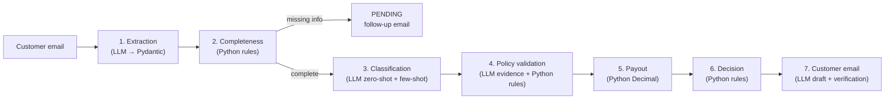

# AI-Assisted Insurance Claims Processing

    

This project processes insurance claim emails from start to finish. For each email it extracts the details, finds what is missing, classifies the claim, checks it against the policy, calculates the payout and decides **APPROVED / REJECTED / PENDING**. It then drafts the reply to the customer.

It is built with **plain prompt engineering**: a few well-designed prompts, **Pydantic** for structured output, and ordinary Python for every rule and calculation.

## What this project deliberately does *not* use

| Not used | What is used instead |
|---|---|
| Tool / function calling | Each LLM call is one system + one user message that returns JSON matching a Pydantic schema (`response_format: json_schema`, strict) |
| Agent frameworks (LangChain, LangGraph, CrewAI…) | A plain Python pipeline (`workflow.py`) that calls each step in a fixed order |
| Conversation memory / chat history | Every call is stateless. Context is passed explicitly in the prompt |
| Vector DB / RAG | The policy rules are a small Python dictionary (`policy/catalog.py`) |
| The LLM making decisions or doing maths | The LLM only **reads and writes text**. Python **decides and calculates** (`Decimal`) |

The aim is to show how far **prompting plus schema validation plus deterministic code** can go before agents are needed, and how to make that approach safe to use.

## How it works



| Step | Who does it | Safety mechanism |
|---|---|---|
| Extraction | LLM | Strict JSON schema. Values must appear **verbatim** in the email (grounding), otherwise they are dropped |
| Completeness | Python | Rules CMP-001…006 check the six mandatory fields. Future dates and zero amounts are invalid |
| Classification | LLM ×2 | Zero-shot and few-shot must **agree** with confidence ≥ 0.7. Otherwise the claim goes to human review |
| Policy evidence | LLM | A per-policy `Literal` enum: the LLM may only pick coverages and exclusions that exist in that policy, and must quote the email |
| Policy validation | Python | Rules POL / COV / EXC / DOC / FIN. Quotes are re-checked against the email |
| Payout | Python | `max(0, min(loss, limit) − deductible)` with `Decimal` and ROUND_HALF_UP |
| Decision | Python | Missing info → PENDING. Verified exclusion → REJECTED. Any doubt → PENDING + HUMAN_REVIEW. Otherwise → APPROVED |
| Customer email | LLM | Draft checked for the claim reference, only computed amounts, correct outcome wording and listed items. **Template fallback** if any check fails |

### Prompt engineering techniques
- **RTCO prompts** (Role, Task, Context, Output format) in [`claims/llm/prompts.py`](claims/llm/prompts.py)
- **Zero-shot vs few-shot** classification, with a comparison report. The few-shot examples are synthetic, so there is no test-data leakage
- **Prompt-injection guard**: customer text is wrapped in `<customer_email>` delimiters and treated as data, never as instructions
- **Structured output**: Pydantic model → strict JSON schema (`to_strict_schema`) → validated response
- **Grounding**: nothing the LLM returns is trusted until Python finds it in the source email

## Project structure

```
.
├── claims/                     # Application package
│   ├── __main__.py             # CLI: python -m claims run
│   ├── config.py               # Settings; secrets only from environment / .env
│   ├── models.py               # All Pydantic models
│   ├── money.py                # Decimal parsing and INR formatting
│   ├── ingestion.py            # Email parsing, prompt wrapping, verbatim matching
│   ├── extraction.py           # Step 1: LLM extraction + grounding
│   ├── completeness.py         # Step 2: mandatory-field rules
│   ├── classification.py       # Step 3: zero-shot + few-shot
│   ├── policy/
│   │   ├── catalog.py          # Policy dictionaries (coverage, exclusions, limits)
│   │   ├── matcher.py          # Step 4: LLM evidence (enum-restricted)
│   │   └── validator.py        # Step 4: deterministic policy rules
│   ├── payout.py               # Step 5: payout calculation
│   ├── decision.py             # Step 6: outcome rules
│   ├── communication/
│   │   ├── composer.py         # Step 7: LLM draft + verifier + templates
│   │   └── outbox.py           # Idempotent draft outbox (no duplicate emails)
│   ├── workflow.py             # Orchestrates steps 1–7, fail-safe
│   ├── audit.py                # PII-free JSONL audit trail
│   ├── reporting.py            # Summary and classification reports
│   └── llm/
│       ├── client.py           # Groq client, strict schema, retry/backoff
│       └── prompts.py          # RTCO prompts, few-shot examples, injection guard
├── tests/
│   ├── unit/                   # Rules, payout, parsing, prompts (fake LLM)
│   ├── integration/            # Full workflow + CLI (fake LLM)
│   ├── e2e/                    # Live Groq tests (opt-in)
│   └── fixtures/               # Recorded LLM responses for the 10 emails
├── docs/
│   ├── architecture.md
│   ├── policy_and_financial_rules.md
│   ├── traceability.md         # Requirement → code → test
│   └── test_reports/
├── notebooks/
│   └── claims_walkthrough.ipynb   # Step-by-step demo (calls the package)
├── insurance_claim_emails.txt  # Sample dataset (10 synthetic emails)
├── requirements.txt
├── pytest.ini
├── .env.example
└── LICENSE
```

## Getting started

### 1. Prerequisites

| Requirement | Version | Notes |
|---|---|---|
| Python | 3.12 or newer | Check with `python3 --version` |
| pip | any recent | Comes with Python |
| Git | any | To clone the repository |
| Groq API key | — | Free at [console.groq.com/keys](https://console.groq.com/keys). Needed to **run** the app, not to run the offline tests |
| Internet access | — | Only for live LLM calls |

Python dependencies (installed in step 2, from `requirements.txt`):

| Package | Used for |
|---|---|
| `groq` | LLM API client |
| `pydantic` (v2) | Data models and structured LLM output |
| `python-dotenv` | Loading `GROQ_API_KEY` from `.env` |
| `pytest`, `pytest-cov` | Tests and coverage |
| `nbformat`, `nbclient`, `ipykernel` | Notebook only (optional) |

### 2. Install

```bash
git clone https://github.com/gitjoydeep/ai-claims-processing.git
cd ai-claims-processing

python3 -m venv .venv
source .venv/bin/activate          # Windows (PowerShell): .venv\Scripts\Activate.ps1

pip install --upgrade pip
pip install -r requirements.txt
```

Check that the install worked (no API key needed):

```bash
python -m pytest -q
```
Expected: `157 passed, 12 skipped`. The skipped tests are the live LLM tests and one optional source-file check.

### 3. Configure

```bash
cp .env.example .env               # Windows: copy .env.example .env
```

Open `.env` and add your key:

```dotenv
GROQ_API_KEY=gsk_your_key_here
# CLAIMS_LLM_MODEL=openai/gpt-oss-120b   # optional override
```

| Variable | Required | Default | Description |
|---|---|---|---|
| `GROQ_API_KEY` | yes (for `run`) | — | Your Groq API key |
| `CLAIMS_LLM_MODEL` | no | `openai/gpt-oss-120b` | Any Groq model that supports JSON-schema output |
| `RUN_LIVE_LLM` | no | unset | Set to `1` to enable the live end-to-end tests |

`.env` is in `.gitignore`, so it is never committed. Other settings (confidence threshold 0.7, retries, timeouts) are in `claims/config.py`.

### 4. Run

Run every command from the repository root, with the virtual environment active.

```bash
python -m claims run                    # all 10 sample emails + zero/few-shot comparison (~2–4 min)
python -m claims run --email 4          # one sample email (1–10)
python -m claims run --file mail.txt    # your own email file
python -m claims run --template-emails  # template customer emails (LLM still extracts/classifies)
python -m claims run --no-compare       # skip the classification comparison
python -m claims --help                 # all options
```

To process your own email, create a text file whose first line is `Subject:`, followed by a blank line and the body:

```text
Subject: Car windshield cracked

Hello, my name is Asha Rao. Policy number VEH-2026-1234. On 10 October 2026 a stone hit
my windshield on the highway. Replacement estimate is Rs. 18,000. Photos and the estimate are attached.
```

### 5. Expected output

Console output for `python -m claims run --email 1` (INFO log lines omitted):

```text
EMAIL-01: APPROVED (AUTO_DECIDED)

| Email | Dataset label | Type | Outcome | Internal | Payout | Key reason | Email draft |
|---|---|---|---|---|---|---|---|
| EMAIL-01 | Home Insurance / Complete | Home Insurance | **APPROVED** | AUTO_DECIDED | Rs. 40,000.00 | all rules passed | APPROVAL (llm) |
```

`Internal` is `HUMAN_REVIEW` when the system was unsure and a person should check the claim.

Files written to `outputs/` (created automatically, and git-ignored):

| File | Contents |
|---|---|
| `results/EMAIL-01_CLM-xxxx.json` | The full structured result: extraction, checks, rules, payout steps, decision |
| `summary.md` | Outcome table for the processed emails |
| `classification_report.md` | Zero-shot vs few-shot comparison |
| `outbox/CLM-xxxx_<type>.md` | Customer email draft (approval, rejection or pending) |
| `audit.jsonl` | PII-free audit trail, one line per step |

Example draft (`outputs/outbox/CLM-…_approval.md`):

```text
**Subject:** Claim Approval – CLM-8B285C76

Dear <customer name>,

We are pleased to inform you that your claim (Reference: CLM-8B285C76) has been approved.

- Claimed Amount: Rs. 45,000.00
- Coverage Limit: Rs. 5,00,000.00 (household_items)
- Deductible: Rs. 5,000.00
- Approved Potential Payout: Rs. 40,000.00
...
```

Re-running is safe: an email already in the outbox is not drafted again.

### 6. Notebook (optional)

```bash
python -m ipykernel install --user --name claims --display-name "Python (claims)"
pip install notebook                                     # skip if you use VS Code
jupyter notebook notebooks/claims_walkthrough.ipynb      # or open the file in VS Code
```
Select the **Python (claims)** kernel and run the cells from top to bottom. The notebook walks through each step of the pipeline. The last cells read `outputs/`, so run `python -m claims run` first.

## Testing

```bash
python -m pytest                          # offline: fake LLM, deterministic, no API key, < 2 s
python -m pytest --cov=claims             # with coverage report (97%)
RUN_LIVE_LLM=1 python -m pytest -m live   # live Groq end-to-end: 10 emails + prompt injection (~4 min)
```

| Folder | What it covers |
|---|---|
| `tests/unit/` | Money parsing, grounding, completeness, classification logic, every policy rule, payout, decisions, email verification |
| `tests/integration/` | The full workflow and CLI using recorded LLM responses |
| `tests/e2e/` | Real Groq calls (opt-in) |

## Troubleshooting

| Symptom | Cause | Fix |
|---|---|---|
| `RuntimeError: GROQ_API_KEY is not set` | No `.env`, or the key is empty | `cp .env.example .env` and add the key. Run from the repository root |
| `ModuleNotFoundError: No module named 'claims'` | Command run from the wrong folder | `cd` to the repository root (the folder that contains `claims/`) |
| `ModuleNotFoundError: groq` / `pydantic` | Virtual environment not active, or install skipped | `source .venv/bin/activate` then `pip install -r requirements.txt` |
| `SyntaxError` or typing errors on install or run | Python older than 3.12 | Install Python 3.12+ and recreate `.venv` |
| `WARNING … failed (attempt 1): RateLimitError` | Groq free-tier rate limit | Usually nothing to do: the client waits for `retry-after` and retries up to 6 times. For fewer calls, use `--email N` or `--no-compare` |
| Claim shows `PENDING (HUMAN_REVIEW)` with no email | The LLM failed after all retries (network or quota) | Check your connection and quota, then re-run that email with `--email N` |
| `AuthenticationError` / `401` | Wrong or revoked key | Generate a new key at console.groq.com and update `.env` |
| Model not found / `400` on `response_format` | `CLAIMS_LLM_MODEL` doesn't support JSON-schema output | Remove the override to use `openai/gpt-oss-120b` |
| `Input error: …` (exit code 2) | `--email` out of range or `--file` path wrong | Use `--email 1`…`10`, or check the file path |
| Results differ slightly between runs | LLM output varies | Expected. Grounding and verification send uncertain cases to PENDING, never to a wrong payout |
| Notebook: kernel not found | Kernel not registered | Run the `ipykernel install` command in step 6 |
| Want a fresh run | Old drafts are kept on purpose | Delete the `outputs/` folder |

## Results on the sample dataset

| # | Claim | Outcome | Reason / payout |
|---|---|---|---|
| 1 | Home: burst geyser | APPROVED | Rs. 40,000 (45,000 − 5,000 deductible) |
| 2 | Home: burglary | PENDING | Repair estimate not provided |
| 3 | Home: fire | PENDING | Policy number missing |
| 4 | Vehicle: engine failure | **REJECTED** | Mechanical breakdown / wear and tear excluded |
| 5 | Vehicle: theft | APPROVED | Rs. 6,48,000 (6,50,000 − 2,000) |
| 6 | Vehicle: windshield | PENDING | Claim amount missing |
| 7 | Medical: appendicitis | APPROVED | Rs. 1,20,000 |
| 8 | Medical: dengue | PENDING | Medical reports not provided |
| 9 | Life: natural death | APPROVED | Rs. 15,00,000 (sum assured) |
| 10 | Life: accident | PENDING | Policy number and claim amount missing |

Classification accuracy: zero-shot 10/10, few-shot 10/10.

## Design decisions

- **Fail-safe by default.** Any error or uncertainty gives PENDING + HUMAN_REVIEW, never a wrong approval.
- **Only one path to rejection.** A determinable exclusion with an evidence quote that appears verbatim in the email. Fraud, misrepresentation and similar exclusions go to human review.
- **Policy numbers** are checked by format and prefix only, because no policy register is available.
- **Documents** are required according to the event. For example, a stolen car needs no repair estimate.
- **Money** is always `Decimal`, never `float`.

## Limitations and future work

- No policy register: policy status, dates and remaining limits are not verified. A policy database or API would fix this.
- Attachments are not read. OCR or document parsing would let the system verify them.
- Emails are written as drafts only. There is no SMTP integration.
- There is no claim store, so follow-up emails are not linked to earlier claims.
- A natural next step is to rebuild this with **tool calling and memory** (an agentic version) and compare the two.

## License

[MIT](LICENSE)
