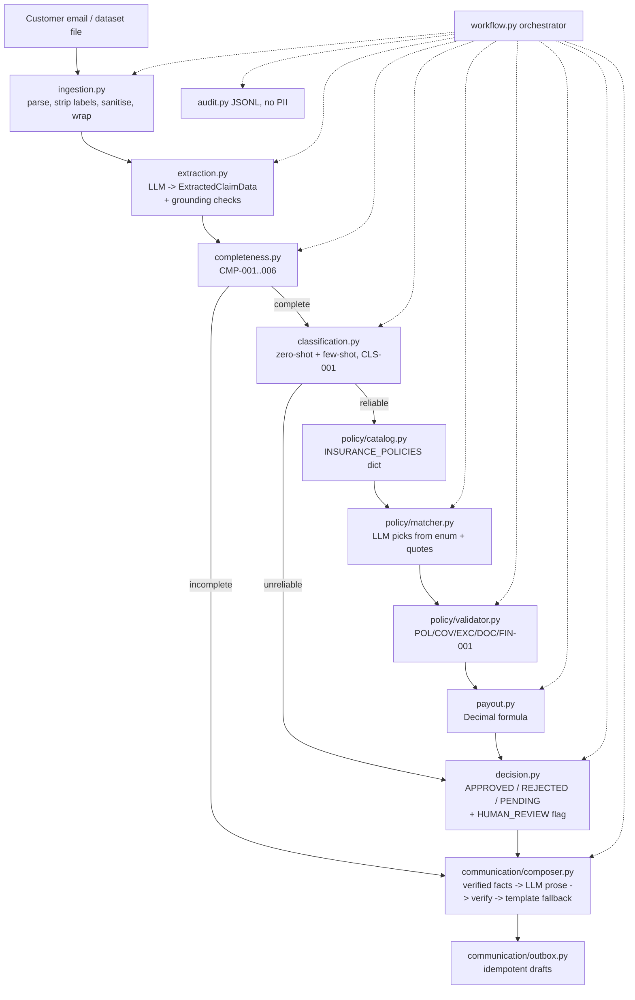
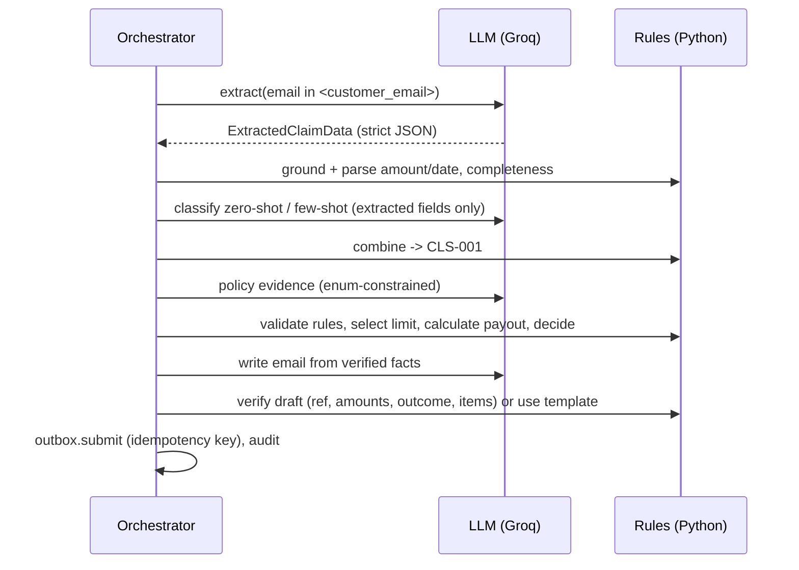

# Architecture

## Design principles
- **The AI reads and writes; the code decides.** The LLM is used for 4 tasks only: extraction, classification, collecting policy evidence, and writing email prose. Completeness, validation, money and the decision are deterministic Python.
- **Every LLM output is validated twice.** First by a strict JSON schema with Pydantic, then by grounding checks: the values and quotes the LLM returns must appear verbatim in the email.
- **Fail-safe.** If an LLM or service fails, the claim becomes PENDING with HUMAN_REVIEW, and no customer email is generated from unverified data.
- **One package, no infrastructure.** A plain Python pipeline with no agent framework, tool calling or memory.

## Component diagram

## Sequence (complete claim)

## Component responsibilities

| # | Component | Implementation |
|---|---|---|
| 1 | Email ingestion | `ingestion.load_dataset`, `parse_email` |
| 2 | Preprocessing | `ingestion.normalise_text`, `wrap_for_prompt`, header stripping |
| 3 | AI extraction | `extraction.ClaimExtractor`, `ground_extraction` |
| 4 | Classification | `classification.ClaimClassifier`, `combine` |
| 5 | Missing-info detection | `completeness.check_completeness`, DOC rules |
| 6 | Policy information | `policy/catalog.py` |
| 7 | Policy validation engine | `policy/validator.py`, with `policy/matcher.py` for evidence |
| 8 | Financial assessment | `payout.calculate_payout`, `validator.select_coverage_limit` |
| 9 | Decision engine | `decision.decide` |
| 10 | Email generation | `communication/composer.py` |
| 11 | Delivery | `communication/outbox.py` (drafts only; no SMTP configuration was supplied) |
| 12 | Orchestration | `workflow.ClaimsProcessor` |
| 13 | Human review | `InternalStatus.HUMAN_REVIEW`, `review_reasons`, `requires_human_review` on rules |
| 14 | Logging and audit | `audit.AuditLog`, stdlib `logging` (claim reference and error type only) |

## Data models (`claims/models.py`)
- **LLM-facing** (strict, all fields required, `extra="forbid"`): `ExtractedClaimData`, `ClassificationLLMOutput`, `EmailDraftLLM`, plus a per-policy `PolicyMatchLLM` built at runtime with `Literal` enums from the policy's own lists.
- **Domain:**
  - `RawEmail`, `ClaimExtraction`, `CompletenessResult`/`FieldCheck`
  - `ClassificationResult`/`ClassificationOutcome`
  - `PolicyMatch`/`ExclusionFinding`, `RuleResult`, `PayoutAssessment`
  - `ClaimDecision` (outcome and internal status are separate)
  - `CustomerEmail`
  - `ClaimResult` (the full JSON response)

Example output: `outputs/results/EMAIL-01_*.json` after a run.

## Security and privacy
- The API key is read only from `.env` or the environment. It is never logged or hardcoded, and `.env.example` is provided.
- Prompt-injection defence:
  - A system-message guard.
  - Delimited customer content, with the closing delimiter neutralised.
  - The LLM has no decision authority.
  - Enum-constrained choices, with quote verification.
  - Email drafts are checked for amounts and outcome wording.
- Classification receives extracted fields only, never the claimant's name or policy number.
- The audit log and logger record claim references, steps, statuses and rule IDs, never names, email text or medical details.
- Size limits, control-character stripping and typed errors apply to untrusted input.

## Technology
Python 3.12, `groq` (model `openai/gpt-oss-120b`, the same as the reference notebook), Pydantic v2, `decimal`, pytest. No database, web server or queue. Outputs are JSON and Markdown files.
